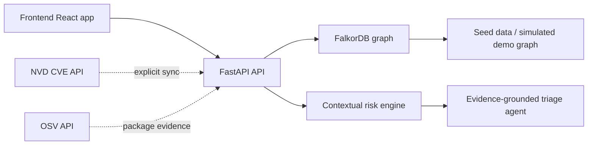

# GHOST

GHOST keeps public vulnerability intelligence separate from environment data. NVD CVEs and OSV package evidence are imported into FalkorDB on demand. The included package, service, exposure, and asset graph remains a **simulated demo environment** unless you replace it with inventory from an authorized environment. A public CVE record does not show that a simulated service is affected.

GHOST is a graph-powered vulnerability intelligence platform for triaging connected security risk. It combines a FastAPI backend with FalkorDB to model vulnerabilities, packages, services, exposures, and data assets as connected graph entities. Instead of judging CVEs only by their public score, the system traverses the graph to calculate contextual risk based on actual service exposure, reachable assets, and attack paths.

## Problem statement

Traditional vulnerability management often treats each CVE as an isolated item. That misses the real operational questions: which services are affected, which internet-facing paths are exposed, and which sensitive business assets are reachable. VulnGraph AI answers those questions by modeling the environment as a graph and calculating risk from evidence grounded in relationships.

## Proposed solution

- Store vulnerability relationship data in FalkorDB.
- Import public NVD CVE data and optional verified OSV package mappings.
- Keep synthetic demo vulnerabilities and simulated infrastructure in an explicit offline mode.
- Query the graph for direct and indirect impact paths.
- Compute contextual risk from graph evidence rather than CVSS alone.
- Explain the result using route-based evidence and recommended actions.
- Persist triage cases in the same graph and let the dashboard reflect them.

## Architecture overview



## Technology stack

- Frontend: React 19 + Vite + Tailwind CSS 4
- Backend: FastAPI + Pydantic
- Graph database: FalkorDB
- AI layer: optional LLM integration with evidence constraints
- Testing: pytest

## Why FalkorDB is essential

FalkorDB is the core of this product. Vulnerability prioritization depends on traversing real graph paths from package to service to exposure to data asset. Removing FalkorDB would break the contextual risk model because the platform would lose the actual relationship evidence that supports the analysis and triage decisions.

## Graph schema

The graph uses a small set of labels and relationship types:

- `Vulnerability`
  - `id`, `cve_id`, `title`, `severity`, `cvss_score`, `published_date`, `modified_date`, `references`, `source`, `record_type`, `last_synchronized_at`
- `Package`
  - `id`, `name`, `version`, `ecosystem`, `criticality`
- `Service`
  - `id`, `name`, `environment`, `criticality`, `internet_facing`, `business_unit`
- `Exposure`
  - `id`, `type`, `internet_accessible`, `authentication_required`, `network_zone`
- `DataAsset`
  - `id`, `name`, `data_classification`, `business_criticality`
- `TriageCase`
  - `id`, `title`, `status`, `priority`, `assigned_to`

Relationships:

- `(Vulnerability)-[:AFFECTS_PACKAGE {source, mapping_status, ranges_json}]->(Package)`
- `(Package)-[:USED_BY]->(Service)`
- `(Service)-[:HAS_EXPOSURE]->(Exposure)`
- `(Service)-[:ACCESS_TO]->(DataAsset)`
- `(Vulnerability)-[:HAS_CASE]->(TriageCase)`

## Example Cypher queries

These are representative queries used by the application:

```cypher
// Labels and node counts
MATCH (n) RETURN labels(n) AS labels, count(n) AS count

// Relationship counts
MATCH ()-[r]->() RETURN type(r) AS relationship, count(r) AS count

// Full vulnerability-to-service-to-exposure-and-asset evidence path
MATCH (v:Vulnerability {id: 'vuln-013'})-[:AFFECTS_PACKAGE]->(p:Package)
      -[:USED_BY]->(s:Service)-[:HAS_EXPOSURE]->(e:Exposure),
      (s)-[:ACCESS_TO]->(a:DataAsset)
RETURN v.cve_id, p.name, s.name, e.type, a.name

// Cases attached to one vulnerability
MATCH (v:Vulnerability {id: 'vuln-001'})-[:HAS_CASE]->(c:TriageCase)
RETURN c.id, c.title, c.status, c.priority
```

## Graph traversal and risk scoring

The risk engine combines imported CVSS metadata with environment context. In the included demo graph, that environment context is simulated and the resulting priority is a scenario-based assessment, not proof of real-world exploitability. It combines:

- base CVSS contribution
- exploit availability
- public exposure of the affected service
- reachable critical assets
- business criticality of the service
- number of affected services
- evidence of active triage or mitigation

The formula is normalized into a 0-100 score and mapped to `LOW`, `MEDIUM`, `HIGH`, and `CRITICAL` priorities. The score remains explainable and transparent; it is not presented as a probability estimate.

## AI agent workflow

For each selected vulnerability, the triage agent:

1. Retrieves the vulnerability node.
2. Traverses affected packages and services.
3. Checks exposures and asset reachability.
4. Calculates contextual risk.
5. Produces an evidence-grounded explanation.
6. Recommends remediation steps.
7. Optionally creates or updates a triage case.

If an LLM API key is configured, it can improve wording. If no key exists, a deterministic rule-based generator is used. The LLM is never allowed to invent graph relationships; it must operate only on evidence returned from FalkorDB.

## Installation and prerequisites

- Python 3.11+
- Node.js 18+
- Docker and Docker Compose (optional, for FalkorDB and backend)
- Access to a local or containerized FalkorDB instance

## FalkorDB Docker setup

Create the named volume and shared Docker network first. The commands are safe for this existing installation: they reuse the existing volume and create the network only if it is missing.

```powershell
docker volume create graphhacks_falkordb_persistent
if (-not (docker network ls --filter 'name=^graphhacks_default$' --quiet)) { docker network create graphhacks_default }
```

Start the graph database using Docker Compose:

```powershell
cd "C:\Users\khush\Downloads\Hackathon-main (3)\Graph HacKs"
docker compose up -d falkordb
```

For local direct connectivity, the backend defaults to:

- host: `localhost`
- port: `6379`
- graph: `vulngraph`

When running the backend inside Docker, the host resolves to `falkordb` from the Compose network. The app reads environment variables from `.env` or the runtime environment.

## Environment configuration

Copy the example environment file:

```powershell
Copy-Item .env.example .env
```

Then set values as needed:

```env
FALKORDB_HOST=localhost
FALKORDB_PORT=6379
FALKORDB_USERNAME=
FALKORDB_PASSWORD=
FALKORDB_GRAPH_NAME=vulngraph
LLM_PROVIDER=none
LLM_API_KEY=
LLM_MODEL=gpt-4o-mini
APP_ENV=development
DEBUG=true
API_CORS_ORIGINS=http://localhost:5173,http://localhost:5174,http://localhost:5175,http://localhost:3000
```

## Seed-data instructions

Run:

```powershell
cd "C:\Users\khush\Downloads\Hackathon-main (3)\Graph HacKs\backend"
python -m app.seed
```

This script refreshes only nodes labelled `source=synthetic_fixture` and populates demo vulnerabilities, simulated packages, services, exposures, data assets, and triage cases. It preserves imported NVD/OSV data.

## Public vulnerability data and provenance

- NVD CVE API 2.0: <https://services.nvd.nist.gov/rest/json/cves/2.0>. Imported records include the CVE ID, English description when available, CVSS metrics when present, severity, publication/modification dates, references, and CPE affected-product/version-bound evidence when present. Missing CVSS remains null with severity `unknown`; it is not replaced with a made-up score.
- OSV API: <https://api.osv.dev/v1/query> and the OSV vulnerability record endpoint. OSV package names, ecosystems, versions, and ranges are saved only when returned by OSV. A verified `AFFECTS_PACKAGE` relationship is created for that evidence. No public record is automatically connected to a simulated service, exposure, or asset.
- Provenance fields are returned with vulnerability records: `source` (`NVD`, `OSV`, or `synthetic_fixture`), `record_type` (`real_public_vulnerability` or fixture/simulated entity), `last_synchronized_at`, and `affected_package_mapping` (`verified`, `inferred`, or `unavailable`). Simulation-assumption graph edges are marked `source=synthetic_fixture` and `mapping_status=inferred_simulation`.
- `VULN_DATA_MODE=demo` is the offline default. Set it to `NVD` after importing to show public records, or explicitly request `source=all` to combine sources. The UI keeps the source selector visible; it never silently mixes sources in the inventory.

### Synchronization

With FalkorDB running, from `backend` run:

```powershell
python -m app.sync --days 30
python -m app.sync --cve-id CVE-2024-3094
python -m app.sync --days 7 --no-osv
```

The idempotent import upserts vulnerability/package nodes and relationships. `--days` accepts 1-120 days. The API also exposes `POST /api/vulnerabilities/refresh?days=30` (optionally `&cve_id=CVE-...` or `&include_osv=false`). Dashboard requests only read FalkorDB; they do not contact external APIs. NVD pagination uses `startIndex`/`resultsPerPage`, capped at 2,000 per page. The default six-second interval is conservative for the unauthenticated NVD limit (5 requests per 30 seconds); an optional `NVD_API_KEY` may be configured. Timeouts and page size are configurable with `NVD_TIMEOUT_SECONDS`, `NVD_PAGE_SIZE`, and `NVD_REQUEST_INTERVAL_SECONDS`. OSV requests use `OSV_TIMEOUT_SECONDS` and its returned package metadata.

### Limitations

NVD CPE products are not assumed to be package-manager packages. OSV mapping is public package evidence and does not mean that the package is installed in your environment. The included environment graph is synthetic; contextual priority combines public CVSS with this scenario context and does not prove real-world exposure or exploitability. Replace simulated environment data only with an authorized inventory integration. NVD and OSV availability, completeness, and update timing are controlled by their operators.

### FalkorDB persistence boundary

Compose mounts the named Docker volume `graphhacks_falkordb_persistent` at FalkorDB's `/var/lib/falkordb/data` directory. It enables periodic RDB snapshots and AOF (`appendfsync everysec`), so the graph is stored outside the container and can be loaded when a container is recreated. A fresh FalkorDB container was started against this volume and loaded all 48 nodes, 46 relationships, and 3 cases; only one FalkorDB process was allowed to write to the volume at a time. The AOF setting limits the normal crash-loss window to about one second; backups are still required. The Compose project uses a separate project name and retains the previous containers under `*-original` names during the one-time migration. Do not remove the volume with `docker compose down -v` or `docker volume rm`.

For an independent graph backup, the supported Redis `DUMP` command serializes the graph key. Use a binary-safe client (not `redis-cli --raw` redirection) and keep the result outside the database volume. Example from PowerShell:

```powershell
New-Item -ItemType Directory -Force "$env:USERPROFILE\Downloads\GraphHacks-backups" | Out-Null
docker compose exec -T backend python -c "import redis; r=redis.Redis(host='falkordb',port=6379); open('/tmp/vulngraph.dump','wb').write(r.dump('vulngraph'))"
docker cp vulngraph-backend-durable:/tmp/vulngraph.dump "$env:USERPROFILE\Downloads\GraphHacks-backups\vulngraph-$(Get-Date -Format yyyyMMdd-HHmmss).dump"
```

The graph-specific dump must be restored using Redis `RESTORE` (or `redis-py`'s `restore` method) into a compatible FalkorDB version. Verify node, relationship, and case counts after restore. A raw Redis RDB file is not a substitute for this graph-specific backup in this setup.

### One-time safe cutover from the original container

The existing database volume was populated from a binary-safe graph dump, verified through an isolated-container restart, and then loaded by a newly created FalkorDB container: 48 nodes, 46 relationships, and all 3 triage cases were present. The migration below keeps the original database and backend containers stopped but intact under renamed `*-original` names; Compose uses a separate project name and the already verified volume.

Run these commands once, from the repository root, after taking a fresh graph backup. For a legacy installation, create that backup before the switch:

```powershell
New-Item -ItemType Directory -Force "$env:USERPROFILE\Downloads\GraphHacks-backups" | Out-Null
docker exec vulngraph-backend python -c "import redis; r=redis.Redis(host='falkordb',port=6379); open('/tmp/vulngraph-pre-cutover.dump','wb').write(r.dump('vulngraph'))"
docker cp vulngraph-backend:/tmp/vulngraph-pre-cutover.dump "$env:USERPROFILE\Downloads\GraphHacks-backups\vulngraph-pre-cutover-$(Get-Date -Format yyyyMMdd-HHmmss).dump"
```

Then switch the containers:

```powershell
docker stop vulngraph-backend vulngraph-falkordb
docker rename vulngraph-backend vulngraph-backend-original
docker rename vulngraph-falkordb vulngraph-falkordb-original
docker compose up -d falkordb backend
```

After startup, verify counts and case records before removing or changing anything. Do not remove the `*-original` containers or either backup until you have confirmed the application works.

## Backend startup instructions

From PowerShell at the repository root, start the database and API without reseeding:

```powershell
docker volume create graphhacks_falkordb_persistent
docker compose up -d falkordb backend
docker compose ps
```

Start the frontend in a second PowerShell window:

```powershell
cd "C:\Users\khush\Downloads\Hackathon-main (3)\Graph HacKs\frontend"
npm run dev
```

Open `http://localhost:5173` (UI), `http://localhost:8000/docs` (API), or `http://localhost:3000` (FalkorDB Browser). Choose the `vulngraph` graph to inspect its nodes and relationships. Port `6379` is the Redis-compatible database protocol, not a web page; to query it from PowerShell, use `docker exec -it vulngraph-falkordb-durable redis-cli` and issue `GRAPH.QUERY` commands. Stop application containers without deleting graph storage with `docker compose stop`.

For local Python development instead of the backend container, start only FalkorDB with `docker compose up -d falkordb`, then run:

```powershell
cd "C:\Users\khush\Downloads\Hackathon-main (3)\Graph HacKs\backend"
python -m uvicorn app.main:app --host 0.0.0.0 --port 8000 --reload
```

Do not run the seed script as part of normal startup. It is for initializing or intentionally refreshing the synthetic demo fixtures.

## Vercel hackathon demo

The React/Vite frontend is deployed at <https://ghost-iota-wheat.vercel.app>. Its API and FalkorDB remain in Docker on the demo computer. For a temporary live demo, install Cloudflare Tunnel and run this in a separate PowerShell window:

```powershell
cloudflared tunnel --url http://localhost:8000
```

Copy the generated `https://….trycloudflare.com` URL into the Vercel project's `VITE_API_BASE_URL` environment variable for Production, then redeploy. The backend's `API_CORS_ORIGINS` must include the Vercel site origin. Never expose FalkorDB ports `6379` or `3000` through the tunnel.

This quick tunnel is temporary: the demo computer must remain powered on, awake, connected to the internet, and running Docker and `cloudflared`. Closing or sleeping the computer, stopping either service, or restarting the quick tunnel disconnects the online app; a new tunnel URL requires updating the Vercel variable and redeploying. The demo API has no authentication, so use only synthetic demo data, keep the tunnel active only for the presentation, and stop it afterward with Ctrl+C. This is not a production hosting setup.

## 2–3 minute demo recording script

1. **0:00–0:20 — Start and connect.** Show Docker Compose with FalkorDB healthy and the UI's “Live graph connected” indicator. State that infrastructure entities are synthetic demo context.
2. **0:20–0:45 — Explain the graph.** Show the live metrics and the source selector. Explain that public NVD/OSV vulnerability records, when imported, are separate from simulated services, exposures, and assets.
3. **0:45–1:25 — Follow a real stored path.** Select `CVE-2024-DEMO-013`. Show `sharp → media-processor → Upload Endpoint → Profile Images` and the actual relationship labels `AFFECTS_PACKAGE → USED_BY → HAS_EXPOSURE → ACCESS_TO`.
4. **1:25–1:55 — Explain prioritization.** Show the contextual risk score and recommended actions. Explain that CVSS, exploit availability, exposure, reachable assets, service criticality, and triage state contribute; the score is not a probability.
5. **1:55–2:20 — Show persistence.** In the API docs or terminal, show the three existing triage cases and named volume configuration. State that the database volume and backups must not be removed.
6. **2:20–2:40 — Close.** Summarize that the UI reports graph-backed evidence and that synthetic infrastructure does not prove real-world exposure.

## API endpoint documentation

- `GET /api/health`
- `GET /api/health/database`
- `GET /api/dashboard/summary`
- `GET /api/dashboard/severity-distribution`
- `GET /api/dashboard/risk-trends`
- `GET /api/vulnerabilities`
- `GET /api/vulnerabilities/{vulnerability_id}`
- `GET /api/vulnerabilities/{vulnerability_id}/impact`
- `GET /api/vulnerabilities/{vulnerability_id}/related`
- `GET /api/services/{service_id}`
- `POST /api/triage/{vulnerability_id}/analyze`
- `GET /api/cases`
- `POST /api/cases`
- `PATCH /api/cases/{case_id}`
- `GET /api/reports/export`

## Testing instructions and verified results

Run:

```powershell
cd "C:\Users\khush\Downloads\Hackathon-main (3)\Graph HacKs\backend"
python -m pytest
```

The application is designed to validate graph logic while gracefully handling missing connectivity by returning explicit 503 responses instead of silent fallback data.

## Demo dataset explanation

The included dataset contains synthetic fixtures and simulated packages, services, exposures, and sensitive data. Its CVE-like identifiers and relationships are not real vulnerability intelligence. All are labelled `synthetic_fixture`; environment relationships encode demo assumptions only.

## Limitations and future improvements

- The dataset is synthetic and meant for demo scenarios.
- LLM integration is optional and must remain evidence-bound.
- The current graph model is intentionally compact for a hackathon-ready implementation.
- Further work could add richer dependency trees and an authorized environment inventory integration.

## Demo recording flow

1. Start FalkorDB and the backend.
2. Run the seed script.
3. Open the frontend dashboard.
4. Select a vulnerability with a public exposure path.
5. Show the graph evidence and the triage explanation.
6. Create a triage case and update its status.
7. Refresh the dashboard to confirm the metrics reflect the updated case state.

## Selected hackathon track

Agents That Act on Connected Data

## AI coding assistant disclosure

This project was implemented in the local workspace with the assistance of an AI coding assistant. The application logic, graph queries, backend routes, and frontend integration were created in-place and validated with the available toolchain.

## Implementation notes

The product uses FalkorDB not as decoration but as the source of truth for graph relationships. A vulnerability is not evaluated in isolation: it is connected to the packages it affects, the services that use those packages, the internet exposures visible to attackers, and the sensitive data assets those services can reach. That relationship-based evidence is precisely what makes the contextual prioritization and evidence-grounded triage agent work.
